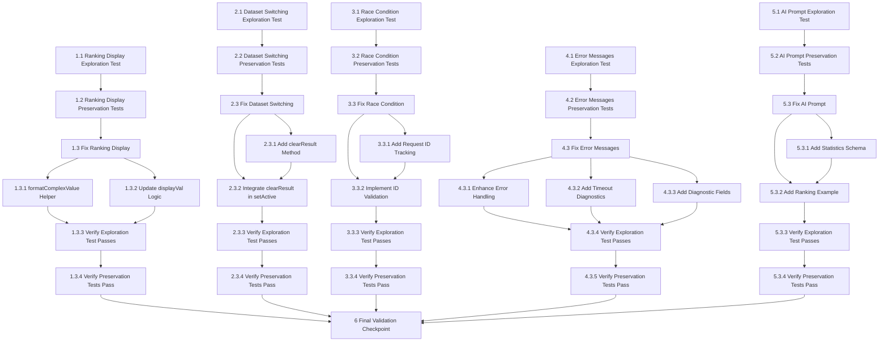

# Implementation Plan

## Overview

This task list implements fixes for five critical production bugs in DataPilot AI using the exploratory bugfix workflow. Each bug follows the three-phase approach: (1) exploration tests to confirm the bug exists, (2) preservation tests to capture baseline behavior, and (3) implementation with verification. The bugs are: ranking display rendering, dataset switching state management, race condition handling, error message diagnostics, and AI system prompt schema specification.

## Task Dependency Graph

```json
{
  "waves": [
    {
      "name": "Wave 1: Exploration Tests",
      "tasks": ["1.1", "2.1", "3.1", "4.1", "5.1"]
    },
    {
      "name": "Wave 2: Preservation Tests",
      "tasks": ["1.2", "2.2", "3.2", "4.2", "5.2"]
    },
    {
      "name": "Wave 3: Implementation - Bug 1 & 5",
      "tasks": ["1.3.1", "1.3.2", "5.3.1", "5.3.2"]
    },
    {
      "name": "Wave 4: Implementation - Bug 2 & 3",
      "tasks": ["2.3.1", "2.3.2", "3.3.1", "3.3.2"]
    },
    {
      "name": "Wave 5: Implementation - Bug 4",
      "tasks": ["4.3.1", "4.3.2", "4.3.3"]
    },
    {
      "name": "Wave 6: Verification - Exploration Tests",
      "tasks": ["1.3.3", "2.3.3", "3.3.3", "4.3.4", "5.3.3"]
    },
    {
      "name": "Wave 7: Verification - Preservation Tests",
      "tasks": ["1.3.4", "2.3.4", "3.3.4", "4.3.5", "5.3.4"]
    },
    {
      "name": "Wave 8: Final Validation",
      "tasks": ["6"]
    }
  ]
}
```



**Key Dependencies:**
- Each bug is independent and can be worked on in parallel
- Within each bug: exploration test → preservation tests → implementation → verification
- All bug fixes must complete before final validation checkpoint
- Implementation sub-tasks within each bug can be parallelized where logical

## Tasks

### Bug 1: Ranking Display Issue

- [ ] 1.1 Write bug condition exploration test for ranking display
  - **Property 1: Bug Condition** - Statistics Rendering for Complex Data
  - **CRITICAL**: This test MUST FAIL on unfixed code - failure confirms the bug exists
  - **DO NOT attempt to fix the test or the code when it fails**
  - **NOTE**: This test encodes the expected behavior - it will validate the fix when it passes after implementation
  - **GOAL**: Surface counterexamples that demonstrate unreadable object references in UI
  - **Scoped PBT Approach**: Scope the property to cases where statistics contain arrays or objects
  - Create mock analysis result with `statistics: { rankings: [{name: "Ayesha", value: 22}, {name: "Nauman", value: 20}] }`
  - Render AnalysisResult component with this data
  - Test that rendered output does NOT contain "[object Object]" (this is the expected behavior)
  - Run test on UNFIXED code
  - **EXPECTED OUTCOME**: Test FAILS with assertion showing "[object Object]" in rendered text
  - Document counterexample: "Ranking display shows '[object Object],[object Object]' instead of '1. Ayesha — 22 | 2. Nauman — 20'"
  - Mark task complete when test is written, run, and failure is documented
  - _Requirements: 1.1, 1.2, 2.1, 2.2, 2.3_

- [ ] 1.2 Write preservation property tests for ranking display (BEFORE implementing fix)
  - **Property 2: Preservation** - Non-Complex Statistics Rendering
  - **IMPORTANT**: Follow observation-first methodology
  - Observe behavior on UNFIXED code for statistics containing only numbers and simple strings
  - Create test cases with scalar statistics: `{ total: 150, average: 45.5, label: "Complete" }`
  - Render with AnalysisResult component and capture the exact rendered output
  - Write property-based test: for all statistics with scalar values only, rendered format matches observed pattern
  - Property-based testing generates 100+ test cases for stronger guarantees
  - Run tests on UNFIXED code
  - **EXPECTED OUTCOME**: Tests PASS (confirms baseline rendering to preserve)
  - Mark task complete when tests are written, run, and passing on unfixed code
  - _Requirements: 3.1, 3.2, 3.3_

- [ ] 1.3 Fix for ranking display issue

  - [ ] 1.3.1 Implement formatComplexValue helper function in AnalysisResult.tsx
    - Add `formatComplexValue(val: any): string` helper before stats.map()
    - Handle arrays: check if elements are objects with name/value properties
    - Format array of objects as: "1. Name — Value | 2. Name — Value"
    - Format array of primitives as: "1. Item | 2. Item"
    - Handle plain objects: convert to "Key: Value | Key: Value" format
    - Return String(val) for all other types
    - _Bug_Condition: isBugCondition_Ranking(statValue) where typeof statValue === 'object' AND (Array.isArray OR isPlainObject)_
    - _Expected_Behavior: renderedText does NOT include "[object Object]" AND includes formatted list items_
    - _Preservation: Statistics with scalar values render identically to original_
    - _Requirements: 1.1, 1.2, 2.1, 2.2, 2.3, 3.1, 3.2, 3.3_

  - [ ] 1.3.2 Update displayVal logic to use formatComplexValue
    - Modify stats.map() callback in AnalysisResult.tsx
    - Add check for Array.isArray(val) before number check
    - Add check for plain objects (val !== null && typeof val === 'object')
    - Call formatComplexValue for arrays and objects
    - Preserve existing number formatting (toLocaleString, toFixed)
    - Preserve existing string handling
    - _Requirements: 2.1, 2.2, 2.3_

  - [ ] 1.3.3 Verify bug condition exploration test now passes
    - **Property 1: Expected Behavior** - Statistics Rendering for Complex Data
    - **IMPORTANT**: Re-run the SAME test from task 1.1 - do NOT write a new test
    - The test from task 1.1 encodes the expected behavior
    - Run bug condition exploration test with mock analysis result containing array data
    - **EXPECTED OUTCOME**: Test PASSES (rendered output shows "1. Ayesha — 22 | 2. Nauman — 20")
    - Verify no "[object Object]" appears in any rendered statistics
    - _Requirements: 2.1, 2.2, 2.3_

  - [ ] 1.3.4 Verify preservation tests still pass
    - **Property 2: Preservation** - Non-Complex Statistics Rendering
    - **IMPORTANT**: Re-run the SAME tests from task 1.2 - do NOT write new tests
    - Run preservation property tests with scalar statistics
    - **EXPECTED OUTCOME**: Tests PASS (confirms no regressions in number/string rendering)
    - Verify all 100+ generated test cases pass
    - _Requirements: 3.1, 3.2, 3.3_

## Bug 2: Dataset Switching State Management

- [ ] 2.1 Write bug condition exploration test for dataset switching
  - **Property 1: Bug Condition** - Dataset Switching Clears Analysis
  - **CRITICAL**: This test MUST FAIL on unfixed code - failure confirms the bug exists
  - **DO NOT attempt to fix the test or the code when it fails**
  - **NOTE**: This test encodes the expected behavior - it will validate the fix when it passes after implementation
  - **GOAL**: Surface counterexamples that demonstrate stale analysis persisting after dataset switch
  - **Scoped PBT Approach**: Scope to cases where activeDataset changes and currentResult exists
  - Set up initial state: dataset A active, analysis result from dataset A in analysisStore
  - Call `setActive(datasetB)` where datasetB.dataset_id !== datasetA.dataset_id
  - Test that `currentResult` is null after switch (this is the expected behavior)
  - Test that `isRunning` is false after switch
  - Test that `error` is null after switch
  - Run test on UNFIXED code
  - **EXPECTED OUTCOME**: Test FAILS with assertions showing currentResult still contains dataset A's analysis
  - Document counterexample: "After switching from employees.csv to sales.csv, UI still displays salary bar chart from employees.csv"
  - Mark task complete when test is written, run, and failure is documented
  - _Requirements: 1.3, 1.4, 1.5, 2.4, 2.5, 2.6_

- [ ] 2.2 Write preservation property tests for dataset operations (BEFORE implementing fix)
  - **Property 2: Preservation** - Dataset Operations Without Analysis
  - **IMPORTANT**: Follow observation-first methodology
  - Observe behavior on UNFIXED code for dataset operations when no analysis exists
  - Create test cases: upload dataset, select dataset, remove dataset (all with analysisStore.currentResult === null)
  - Capture datasetStore state after each operation
  - Write property-based test: for all dataset operations without existing analysis, state changes match observed pattern
  - Property-based testing generates varied dataset operation sequences
  - Run tests on UNFIXED code
  - **EXPECTED OUTCOME**: Tests PASS (confirms baseline dataset management to preserve)
  - Mark task complete when tests are written, run, and passing on unfixed code
  - _Requirements: 3.4, 3.5, 3.6_

- [ ] 2.3 Fix for dataset switching state management

  - [ ] 2.3.1 Add clearResult method to analysisStore.ts
    - Open `frontend/src/store/analysisStore.ts`
    - Add `clearResult: () => void` to AnalysisState interface
    - Implement: `clearResult: () => set({ currentResult: null, isRunning: false, error: null })`
    - Export method as part of the store
    - _Bug_Condition: isBugCondition_Switching(event) where event.newDatasetId !== previousDatasetId AND currentResult !== null_
    - _Expected_Behavior: After clearResult(), currentResult === null AND isRunning === false AND error === null_
    - _Preservation: All other analysisStore methods unchanged_
    - _Requirements: 2.4, 2.5_

  - [ ] 2.3.2 Integrate clearResult into datasetStore setActive method
    - Open `frontend/src/store/datasetStore.ts`
    - Add import: `import { useAnalysisStore } from './analysisStore'`
    - Modify `setActive` method to detect dataset ID change
    - Add conditional: `if (activeDataset?.dataset_id !== state.activeDataset?.dataset_id)`
    - Call `useAnalysisStore.getState().clearResult()` when dataset changes
    - Place call before or after `set({ activeDataset })`
    - _Requirements: 2.5, 2.6_

  - [ ] 2.3.3 Verify bug condition exploration test now passes
    - **Property 1: Expected Behavior** - Dataset Switching Clears Analysis
    - **IMPORTANT**: Re-run the SAME test from task 2.1 - do NOT write a new test
    - The test from task 2.1 encodes the expected behavior
    - Set up dataset A with analysis, switch to dataset B
    - Run test to verify currentResult is null after switch
    - **EXPECTED OUTCOME**: Test PASSES (analysisStore is cleared)
    - Verify isRunning and error are also reset
    - _Requirements: 2.4, 2.5, 2.6_

  - [ ] 2.3.4 Verify preservation tests still pass
    - **Property 2: Preservation** - Dataset Operations Without Analysis
    - **IMPORTANT**: Re-run the SAME tests from task 2.2 - do NOT write new tests
    - Run preservation property tests for dataset operations without existing analysis
    - **EXPECTED OUTCOME**: Tests PASS (confirms no regressions in dataset management)
    - Verify dataset list, activeDataset, and all operations work identically
    - _Requirements: 3.4, 3.5, 3.6_

## Bug 3: Race Condition in Analysis Requests

- [ ] 3.1 Write bug condition exploration test for race conditions
  - **Property 1: Bug Condition** - Race Condition Prevention
  - **CRITICAL**: This test MUST FAIL on unfixed code - failure confirms the bug exists
  - **DO NOT attempt to fix the test or the code when it fails**
  - **NOTE**: This test encodes the expected behavior - it will validate the fix when it passes after implementation
  - **GOAL**: Surface counterexamples that demonstrate stale results overwriting newer results
  - **Scoped PBT Approach**: Scope to cases where multiple requests are submitted with overlapping timing
  - Mock API with delayed responses: Request A (2000ms delay), Request B (100ms delay)
  - Submit Request A at time T, submit Request B at time T+50ms
  - Wait for both to complete
  - Test that `currentResult.analysis_id === requestB.analysis_id` (this is the expected behavior)
  - Run test on UNFIXED code
  - **EXPECTED OUTCOME**: Test FAILS with assertion showing currentResult has Request A's analysis_id
  - Document counterexample: "User submits 'show salary distribution' then 'count departments'. Salary chart appears after department count, overwriting newer result"
  - Mark task complete when test is written, run, and failure is documented
  - _Requirements: 1.6, 1.7, 1.8, 2.7, 2.8, 2.9, 2.10_

- [ ] 3.2 Write preservation property tests for single analysis requests (BEFORE implementing fix)
  - **Property 2: Preservation** - Single Analysis Requests
  - **IMPORTANT**: Follow observation-first methodology
  - Observe behavior on UNFIXED code for single analysis requests with no concurrency
  - Create test cases: submit one analysis, wait for completion, verify result
  - Capture result structure, history updates, loading states
  - Write property-based test: for all single analysis requests, behavior matches observed pattern
  - Property-based testing generates varied analysis prompts and datasets
  - Run tests on UNFIXED code
  - **EXPECTED OUTCOME**: Tests PASS (confirms baseline analysis flow to preserve)
  - Mark task complete when tests are written, run, and passing on unfixed code
  - _Requirements: 3.9, 3.10, 3.11, 3.12, 3.13_

- [ ] 3.3 Fix for race condition in analysis requests

  - [ ] 3.3.1 Add currentRequestId tracking to analysisStore.ts
    - Open `frontend/src/store/analysisStore.ts`
    - Add `currentRequestId: string | null` to AnalysisState interface
    - Add `setRequestId: (id: string | null) => void` method
    - Implement: `setRequestId: (currentRequestId) => set({ currentRequestId })`
    - Initialize `currentRequestId: null` in initial state
    - _Bug_Condition: isBugCondition_RaceCondition(sequence) where req2.completionTime < req1.completionTime_
    - _Expected_Behavior: Only response matching currentRequestId updates state_
    - _Preservation: Single requests work identically_
    - _Requirements: 2.7, 2.8_

  - [ ] 3.3.2 Implement request ID generation and validation in analysis submission handler
    - Locate analysis submission handler (likely in AnalysisInput.tsx or similar component)
    - Before API call: generate UUID with `const requestId = crypto.randomUUID()`
    - Store request ID: call `setRequestId(requestId)` before fetch()
    - After receiving response: validate `if (requestId !== useAnalysisStore.getState().currentRequestId)`
    - If IDs don't match: log warning "Ignoring stale response" and return early
    - If IDs match: proceed with setResult() and call setRequestId(null)
    - Handle errors: clear request ID only if current
    - Handle finally: clear isRunning only if current
    - _Requirements: 2.7, 2.8, 2.9, 2.10_

  - [ ] 3.3.3 Verify bug condition exploration test now passes
    - **Property 1: Expected Behavior** - Race Condition Prevention
    - **IMPORTANT**: Re-run the SAME test from task 3.1 - do NOT write a new test
    - The test from task 3.1 encodes the expected behavior
    - Submit overlapping requests (slow then fast)
    - Run test to verify only latest request updates UI
    - **EXPECTED OUTCOME**: Test PASSES (currentResult shows Request B analysis_id)
    - Verify console shows "Ignoring stale response" for Request A
    - _Requirements: 2.7, 2.8, 2.9, 2.10_

  - [ ] 3.3.4 Verify preservation tests still pass
    - **Property 2: Preservation** - Single Analysis Requests
    - **IMPORTANT**: Re-run the SAME tests from task 3.2 - do NOT write new tests
    - Run preservation property tests for single analysis requests
    - **EXPECTED OUTCOME**: Tests PASS (confirms no regressions in normal analysis flow)
    - Verify result display, history tracking, loading states all work identically
    - _Requirements: 3.9, 3.10, 3.11, 3.12, 3.13_

## Bug 4: Generic Error Messages

- [ ] 4.1 Write bug condition exploration test for error messages
  - **Property 1: Bug Condition** - Detailed Error Messages
  - **CRITICAL**: This test MUST FAIL on unfixed code - failure confirms the bug exists
  - **DO NOT attempt to fix the test or the code when it fails**
  - **NOTE**: This test encodes the expected behavior - it will validate the fix when it passes after implementation
  - **GOAL**: Surface counterexamples that demonstrate generic error messages hiding diagnostic details
  - **Scoped PBT Approach**: Scope to cases where execution fails with non-empty stdout and empty stderr
  - Mock sandbox execution: `exit_code=1`, `stderr=""`, `stdout="Traceback (most recent call last):\n  File '<string>', line 5\n    df.gropby('dept')\nAttributeError: 'DataFrame' object has no attribute 'gropby'"`
  - Call sandbox service _run_docker_container() or equivalent
  - Test that error message includes "AttributeError" (this is the expected behavior)
  - Test that error message includes exit code "exit 1" or "(exit 1)"
  - Run test on UNFIXED code
  - **EXPECTED OUTCOME**: Test FAILS with assertion showing error is "Code execution failed: No error details available"
  - Document counterexample: "Python typo 'gropby' produces traceback in stdout, but error message shows 'No error details available'"
  - Mark task complete when test is written, run, and failure is documented
  - _Requirements: 1.9, 1.10, 1.11, 2.11, 2.12, 2.13_

- [ ] 4.2 Write preservation property tests for successful execution (BEFORE implementing fix)
  - **Property 2: Preservation** - Successful Code Execution
  - **IMPORTANT**: Follow observation-first methodology
  - Observe behavior on UNFIXED code for successful sandbox executions (exit_code=0)
  - Create test cases with valid Python code that produces correct JSON output
  - Execute in sandbox and capture parsed result structure
  - Write property-based test: for all successful executions, result parsing matches observed pattern
  - Property-based testing generates varied valid code samples
  - Run tests on UNFIXED code
  - **EXPECTED OUTCOME**: Tests PASS (confirms baseline result parsing to preserve)
  - Mark task complete when tests are written, run, and passing on unfixed code
  - _Requirements: 3.9, 3.10_

- [ ] 4.3 Fix for generic error messages

  - [ ] 4.3.1 Enhance error handling in sandbox_service.py _run_docker_container
    - Open `backend/app/services/sandbox_service.py`
    - Locate the `if exit_code != 0:` block in _run_docker_container
    - Add logic to check stdout when stderr is empty: `if not stderr.strip() and stdout.strip():`
    - Extract Python tracebacks from stdout: search for lines starting with "Traceback", "Error:", "Exception:"
    - Include exit code in all error messages: `f"Code execution failed (exit {exit_code}):\n..."`
    - If no stderr and no traceback in stdout: use first 800 chars of stdout
    - Add fallback: "No error output captured" if both are empty
    - _Bug_Condition: isBugCondition_ErrorMessages(result) where exitCode !== 0 AND stderr === "" AND stdout contains diagnostic info_
    - _Expected_Behavior: errorMessage includes exitCode AND includes stdout diagnostic content_
    - _Preservation: Successful executions (exit_code=0) parse identically_
    - _Requirements: 1.9, 1.10, 1.11, 2.11, 2.12, 2.13_

  - [ ] 4.3.2 Add timeout error diagnostics
    - Locate timeout exception handler in sandbox_service.py
    - Capture partial stdout before killing container: `container.logs(stdout=True, stderr=False).decode("utf-8", errors="replace")[:500]`
    - Update error message: `f"Execution timed out after {settings.sandbox_timeout_seconds}s.\nPartial output:\n{stdout_partial}"`
    - Add try/except around log capture to handle container removal edge cases
    - _Requirements: 2.12_

  - [ ] 4.3.3 Add optional diagnostic fields to error response
    - In error return dictionaries, add optional fields: `exit_code`, `stdout_preview`, `error_type`
    - For Python errors: set `error_type: "python_error"`
    - For timeouts: set `error_type: "timeout"`
    - Include `stdout_preview: stdout[:300]` when relevant
    - Ensure these fields are optional (won't break existing consumers)
    - _Requirements: 2.11, 2.13_

  - [ ] 4.3.4 Verify bug condition exploration test now passes
    - **Property 1: Expected Behavior** - Detailed Error Messages
    - **IMPORTANT**: Re-run the SAME test from task 4.1 - do NOT write a new test
    - The test from task 4.1 encodes the expected behavior
    - Mock execution with Python error in stdout
    - Run test to verify error message includes "AttributeError" and exit code
    - **EXPECTED OUTCOME**: Test PASSES (error message shows specific diagnostic details)
    - Verify exit code is visible in error message
    - _Requirements: 2.11, 2.12, 2.13_

  - [ ] 4.3.5 Verify preservation tests still pass
    - **Property 2: Preservation** - Successful Code Execution
    - **IMPORTANT**: Re-run the SAME tests from task 4.2 - do NOT write new tests
    - Run preservation property tests for successful executions
    - **EXPECTED OUTCOME**: Tests PASS (confirms no regressions in result parsing)
    - Verify insights, statistics, charts all parse identically
    - _Requirements: 3.9, 3.10_

## Bug 5: AI System Prompt Ambiguity

- [ ] 5.1 Write bug condition exploration test for AI prompt ambiguity
  - **Property 1: Bug Condition** - AI System Prompt Consistency
  - **CRITICAL**: This test MUST FAIL on unfixed code - failure confirms the bug exists
  - **DO NOT attempt to fix the test or the code when it fails**
  - **NOTE**: This test encodes the expected behavior - it will validate the fix when it passes after implementation
  - **GOAL**: Surface counterexamples that demonstrate AI generating incompatible data structures
  - **Scoped PBT Approach**: Scope to analysis prompts requesting rankings, lists, or top-N results
  - Create test prompt: "Show top 3 employees by sales"
  - Mock AI service to use current system prompt and generate code
  - Parse generated code to extract RESULT structure
  - Test that all statistics values are typeof 'number' OR typeof 'string' (this is the expected behavior)
  - Test that NO statistics values are arrays or objects
  - Run test on UNFIXED code (or mock AI to generate array structures)
  - **EXPECTED OUTCOME**: Test FAILS with assertion showing statistics contains array/object
  - Document counterexample: "AI generates RESULT['statistics']['top_performers'] = [{name: 'Ayesha', value: 22}, ...] instead of string format"
  - Mark task complete when test is written, run, and failure is documented
  - _Requirements: 1.12, 1.13, 2.14, 2.15_

- [ ] 5.2 Write preservation property tests for AI code generation (BEFORE implementing fix)
  - **Property 2: Preservation** - Code Generation Quality
  - **IMPORTANT**: Follow observation-first methodology
  - Observe behavior on UNFIXED code for analysis prompts that don't request rankings
  - Create test cases with prompts: "What's the average salary?", "Show distribution by department", "Count total records"
  - Generate code with AI service and execute in sandbox
  - Capture result quality: insights present, statistics populated, charts valid
  - Write property-based test: for all non-ranking prompts, code quality matches observed baseline
  - Property-based testing generates varied analysis prompts
  - Run tests on UNFIXED code
  - **EXPECTED OUTCOME**: Tests PASS (confirms baseline AI code generation to preserve)
  - Mark task complete when tests are written, run, and passing on unfixed code
  - _Requirements: 3.1, 3.2, 3.3, 3.7, 3.8, 3.9, 3.10_

- [ ] 5.3 Fix for AI system prompt ambiguity

  - [ ] 5.3.1 Add statistics schema specification to system prompt
    - Open `backend/app/services/ai_service.py`
    - Locate `_CODE_SYSTEM_PROMPT` constant
    - After the RESULT structure example, add new section: "STATISTICS VALUE TYPES (CRITICAL):"
    - Add instruction: "Statistics values MUST be either numbers (int/float) or human-readable strings"
    - Add instruction: "Do NOT assign arrays, lists, or objects to statistics keys"
    - Add instruction: "For rankings/top-N lists, convert to formatted string before assigning"
    - _Bug_Condition: isBugCondition_PromptAmbiguity() where systemPrompt lacks schema specification_
    - _Expected_Behavior: Generated code assigns only numbers or strings to statistics_
    - _Preservation: Non-ranking analysis code quality unchanged_
    - _Requirements: 1.12, 1.13, 2.14, 2.15_

  - [ ] 5.3.2 Add ranking format example to system prompt
    - In the STATISTICS VALUE TYPES section, add "Example — CORRECT:" subsection
    - Provide code example:
      ```python
      top_employees = df.nlargest(3, 'sales')
      ranking_str = " | ".join([f"{i+1}. {row['name']} ({row['sales']})" 
                                for i, row in enumerate(top_employees.itertuples())])
      RESULT["statistics"]["top_performers"] = ranking_str
      ```
    - Add "Example — INCORRECT:" subsection showing what NOT to do:
      ```python
      RESULT["statistics"]["top_performers"] = [{"name": "...", "value": ...}]  # NO!
      ```
    - Add emphasis: "If you have a list/array to display, convert it to a string before assigning"
    - _Requirements: 2.14, 2.15_

  - [ ] 5.3.3 Verify bug condition exploration test now passes
    - **Property 1: Expected Behavior** - AI System Prompt Consistency
    - **IMPORTANT**: Re-run the SAME test from task 5.1 - do NOT write a new test
    - The test from task 5.1 encodes the expected behavior
    - Submit prompt requesting rankings with updated system prompt
    - Run test to verify generated code uses string formatting for rankings
    - **EXPECTED OUTCOME**: Test PASSES (all statistics values are numbers or strings)
    - Verify no arrays or objects appear in statistics
    - _Requirements: 2.14, 2.15_

  - [ ] 5.3.4 Verify preservation tests still pass
    - **Property 2: Preservation** - Code Generation Quality
    - **IMPORTANT**: Re-run the SAME tests from task 5.2 - do NOT write new tests
    - Run preservation property tests for non-ranking analysis prompts
    - **EXPECTED OUTCOME**: Tests PASS (confirms no regressions in AI code generation)
    - Verify insights quality, statistics correctness, chart validity all preserved
    - _Requirements: 3.1, 3.2, 3.3, 3.7, 3.8, 3.9, 3.10_

## Final Validation

- [ ] 6. Checkpoint - Ensure all tests pass
  - Run all bug condition exploration tests (tasks 1.3.3, 2.3.3, 3.3.3, 4.3.4, 5.3.3)
  - Verify all 5 tests PASS (bugs are fixed)
  - Run all preservation property tests (tasks 1.3.4, 2.3.4, 3.3.4, 4.3.5, 5.3.4)
  - Verify all 5 preservation test suites PASS (no regressions)
  - Run integration test: upload dataset, request analysis with ranking, switch datasets, submit concurrent requests, trigger error
  - Verify end-to-end flow works correctly
  - Document any remaining issues or questions for the user


## Notes

### Testing Strategy

**Exploration Tests (Property 1: Bug Condition)**
- These tests MUST FAIL on unfixed code to confirm the bug exists
- When they fail, document the counterexample to understand the root cause
- After implementation, the SAME test should PASS without modification
- Do NOT attempt to fix the test when it fails initially - the failure is expected

**Preservation Tests (Property 2: Preservation)**
- These tests MUST PASS on unfixed code to capture baseline behavior
- Use observation-first methodology: run unfixed code, observe output, write test
- After implementation, the SAME tests should still PASS without modification
- Use property-based testing (100+ generated cases) for stronger guarantees

**Verification Strategy**
- Re-run exploration tests to verify bugs are fixed
- Re-run preservation tests to verify no regressions
- Do NOT write new tests during verification - reuse existing tests

### File Locations

**Frontend Files:**
- `frontend/src/components/analysis/AnalysisResult.tsx` - Statistics rendering (Bug 1)
- `frontend/src/store/analysisStore.ts` - Analysis state management (Bugs 2, 3)
- `frontend/src/store/datasetStore.ts` - Dataset state management (Bug 2)
- Analysis submission handler (likely `frontend/src/components/analysis/AnalysisInput.tsx`) - Request ID tracking (Bug 3)

**Backend Files:**
- `backend/app/services/sandbox_service.py` - Error handling (Bug 4)
- `backend/app/services/ai_service.py` - System prompt (Bug 5)

### Bug Condition Formulas

**Bug 1 - Ranking Display:**
```
isBugCondition_Ranking(statValue) := 
  (typeof statValue === 'object') AND 
  (statValue !== null) AND 
  (Array.isArray(statValue) OR isPlainObject(statValue)) AND 
  (displayedText includes "[object Object]")
```

**Bug 2 - Dataset Switching:**
```
isBugCondition_Switching(event) := 
  (event.action === "setActive") AND 
  (event.newDatasetId !== event.previousDatasetId) AND 
  (analysisStore.currentResult !== null) AND 
  (analysisStore.currentResult.dataset_id === event.previousDatasetId)
```

**Bug 3 - Race Condition:**
```
isBugCondition_RaceCondition(sequence) := 
  ∃ req1, req2 ∈ sequence WHERE 
  (req2.timestamp > req1.timestamp) AND 
  (req2.completionTime < req1.completionTime) AND 
  (currentResult.analysis_id === req1.analysis_id)
```

**Bug 4 - Error Messages:**
```
isBugCondition_ErrorMessages(result) := 
  (result.exitCode !== 0) AND 
  (result.stderr.trim() === "") AND 
  (errorMessage === "Code execution failed: No error details available") AND 
  (stdout contains diagnostic info)
```

**Bug 5 - AI Prompt:**
```
isBugCondition_PromptAmbiguity(prompt, code) := 
  (systemPrompt includes "statistics") AND 
  (NOT systemPrompt includes "schema for arrays") AND 
  (generatedCode assigns array/object to statistics key)
```

### Implementation Notes

**Bug 1 - Ranking Display:**
- Handle three cases: array of objects (rankings), array of primitives, plain objects
- Format arrays as numbered lists with " | " separator
- Preserve existing number formatting (toLocaleString, toFixed)
- Keep string truncation behavior unchanged

**Bug 2 - Dataset Switching:**
- Add clearResult() to analysisStore (resets currentResult, isRunning, error)
- Call clearResult() from datasetStore.setActive() when dataset ID changes
- Only clear when dataset actually changes (not on re-selection of same dataset)

**Bug 3 - Race Condition:**
- Use crypto.randomUUID() for request ID generation
- Store currentRequestId before making API call
- Validate response matches currentRequestId before updating state
- Log warning and ignore stale responses
- Clear requestId after successful update or error (if still current)

**Bug 4 - Error Messages:**
- Check stdout when stderr is empty
- Look for Python traceback patterns (lines starting with "Traceback", "Error:", "Exception:")
- Include exit code in all error messages: "Code execution failed (exit N):"
- Add optional fields: exit_code, stdout_preview, error_type
- For timeout: capture partial stdout before killing container

**Bug 5 - AI Prompt:**
- Add "STATISTICS VALUE TYPES (CRITICAL):" section to system prompt
- Specify that statistics values must be numbers or strings (not arrays/objects)
- Provide CORRECT example showing string formatting for rankings
- Provide INCORRECT example showing what NOT to do
- Emphasize conversion: "convert to string before assigning"

### Success Criteria

All five bugs are considered fixed when:
1. All exploration tests (Property 1) PASS after implementation
2. All preservation tests (Property 2) PASS after implementation
3. Integration test covering all five bugs completes successfully
4. No new test failures are introduced
5. User can demonstrate: ranking display, dataset switching, concurrent analysis, error diagnostics, AI-generated rankings
